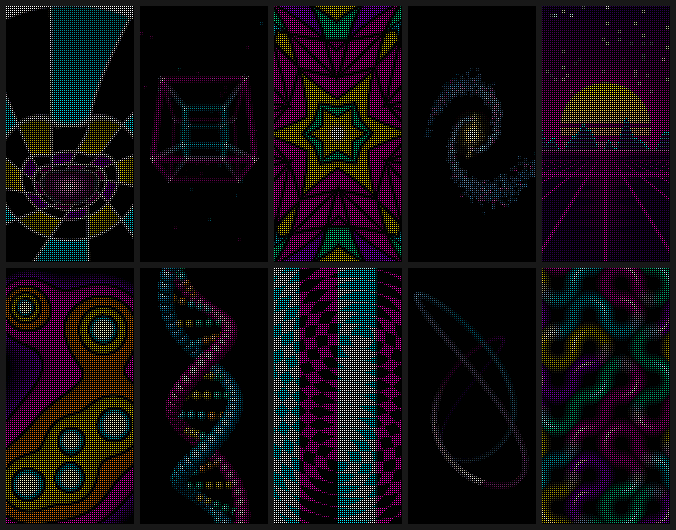
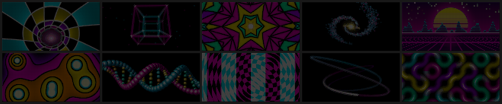

# Neon pack: 10 patterns for Patternflow

Ten animated patterns for the [Patternflow](https://github.com/engmung/Patternflow) LED synth (ESP32-S3, 128×64 HUB75 panel), compiled to installable `.pfm` modules.



## Install

1. Pick the zip that matches how your panel stands:
   - `dist/neon-pack-portrait.zip` if the panel stands upright (64 wide × 128 tall, the usual stand).
   - `dist/neon-pack-landscape.zip` if it lies wide (128 × 64).
2. Open your board's Patterns page, `http://patternflow.local/patterns` (on Android, use the IP shown on the NETWORK screen; hold K2).
3. Drop the `.zip` on **Upload**. Don't unzip it.

The ten patterns appear at the top of the list in the order below. Both zips use the same pattern names, so installing the other one later replaces them. Firmware v3.10.5 or newer is recommended (the web flasher installs the current release).

## The patterns

On every pattern, K4 is **palette** (5–6 high-contrast colour schemes).

| # | Pattern | What it is | K1 | K2 | K3 |
|---|---|---|---|---|---|
| 1 | **Warp Tunnel** | Flying down a curving neon tunnel. Rings race past, the vanishing point wanders, and there's a white-hot light at the end. | speed | twist | curve |
| 2 | **Tesseract** | A 4D hypercube doing a double rotation through the fourth dimension, in true 4D→3D→2D perspective, with phosphor trails and a starfield. | spin | distance | trails |
| 3 | **Kaleido Glass** | A rotating stained-glass rose window: mirrored wedges and a warped lattice of saturated panes held in black leads. | spin | mirrors (3–16) | zoom |
| 4 | **Spiral Galaxy** | 1,300 stars in a 3D barred spiral that turns, nods and rolls, from face-on to an edge-on blade. | spin | tilt | distance |
| 5 | **Outrun** | Synthwave: a striped sun, wireframe mountains, and a perspective neon grid on a curving, banking road. | speed | sun size | curve |
| 6 | **Lava Topo** | Orbiting metaballs drawn as a neon contour map, with bands flowing outward and white-hot cores. | speed | blobs (3–8) | bands |
| 7 | **DNA Helix** | A glossy, ray-shaded 3D double helix with major/minor grooves and four-colour base pairs, z-buffered and in perspective. | spin | twist | distance |
| 8 | **Op Art Moire** | Riley/Vasarely interference: drifting ring emitters and turning gratings XOR into swimming fringes. | speed | scale | mode (4) |
| 9 | **Phosphor Laser** | An oscilloscope laser show: a morphing 3D Lissajous knot with a comet head and afterglow. | morph | figure (8) | glow |
| 10 | **Neon Circuit** | A Truchet maze of neon tubes. Tiles visibly spin and rewire the paths, colour runs along each path, and light pulses travel the circuits. | flow | tile size | rewire |

Landscape: 

## How they were checked

These have not been run on a physical board yet. What was checked:

- **Built with the real toolchain.** Each pattern is cross-compiled with the ESP32-S3 GCC 8.4 (`esp-2021r2-patch5`, the Arduino core's compiler) through Patternflow's own `build_module.py`. It checks every symbol against the firmware's loader table. As a control, the same pipeline reproduces the official Basics pack's `0510.pfm` byte for byte.
- **Accepted by the loader's ELF checks.** All 20 modules pass `firmware/toolchain/tests/module_elf_test.cpp`, the device loader's ELF parsing run on a PC. The largest code segment is 5.6 KB, under the 6 KB internal-RAM line and well under the 16 KB ceiling.
- **Run in a simulator.** `tools/sim/harness.cpp` plays the firmware's part: framebuffer, PSRAM allocator, knob frames on both the turn (delta) and Director (absolute) paths, and the portrait rotation. Every pattern was run under AddressSanitizer and UBSan (including float-to-int overflow) with full knob sweeps, fast knob spins, extremes, and 25-minute runs at large time steps. No errors.
- **Frame time.** Per-pixel loops use no `sqrtf`, division or libm calls; fast multiply-only rsqrt/reciprocal and the firmware's sine table take their place. Instruction counts (valgrind), calibrated against six Basics presets with published on-device times, put every pattern at about 12–30 ms per frame (33–80 fps). Warp Tunnel is the heaviest at ~30 ms. The Basics presets run 10–23 ms.

If something looks different on the panel than in the previews, let me know which pattern and which knob.

## Rebuilding

```bash
git clone https://github.com/engmung/Patternflow /path/to/Patternflow
export PF_REPO=/path/to/Patternflow
export PF_XTENSA_BIN=/path/to/xtensa-esp32s3-elf/bin   # or install the ESP32 Arduino core

python3 tools/pf.py sim tesseract --landscape --abs 3=500   # preview one pattern (.build/look/)
python3 tools/pf.py previews                                # all GIFs
python3 tools/pf.py build                                   # .pfm modules + both zips in dist/
tools/sim/ir.sh .build/sim_p/tesseract/sim                  # rough device frame-time estimate
```

Each `patterns/<slug>/pattern.cpp` is written once against `FW × FH`. The build stamps `PF_PORTRAIT 1` or `0` on top and compiles it twice.

Licence: CC BY-SA 4.0, matching the Patternflow community default.
